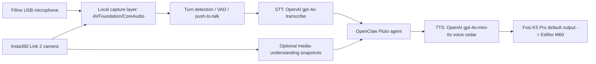

# Pluto Voice Architecture

Operational target: OpenClaw agent `openclaw-main`, identity `Pluto`, local gateway `127.0.0.1:18789`.

## Current Hardware Map

Evidence was collected on macOS through CoreAudio, AVFoundation, and OpenClaw status.

| Role | Preferred device | Current evidence |
| --- | --- | --- |
| Camera | `Insta360 Link 2` | AVFoundation video device `0`; also visible in System Profiler camera data |
| Microphone | `fifine Microphone` input | CoreAudio input default set to `fifine Microphone`; AVFoundation audio device `4` after current enumeration |
| Speakers | `Fosi Audio K5 Pro` output/system | CoreAudio output and system defaults set to `Fosi Audio K5 Pro`; Edifier M60 speakers are downstream of the DAC/AMP |
| Virtual routing | `BlackHole 2ch` | Available for future loopback capture/mix-minus work, not the primary path |

The macOS input volume was set to `100`. An earlier capture used the Fosi input and produced low signal; the correct default input is now the dedicated `fifine Microphone` device.

## Target Architecture



## STT Layer

Primary path:
- Use `openclaw infer audio transcribe` for bounded audio turns.
- Default provider is already configured through OpenClaw's OpenAI provider.
- Preferred model: `openai/gpt-4o-transcribe`.
- Portuguese/English support: pass `--language pt` when the session is Portuguese-heavy, otherwise omit for auto-detection.
- Prompt steering should be short and vocabulary-focused: `Pluto, OpenClaw, Codex, Insta360, Fifine, Edifier, Fosi K5 Pro`.
- Preprocess weak local captures with high-pass filtering, gain normalization, and light compression before sending to STT. This helps only if the signal contains actual speech.

Current live-mic finding:
- `Fosi Audio K5 Pro` captures successfully from AVFoundation audio device `0`, but that is not the preferred Fifine source.
- The correct Fifine source is visible as `fifine Microphone` and is now the CoreAudio default input.
- Earlier Fosi-input live captures remained low (`max_volume` between about `-43 dB` and `-34.5 dB`) and did not produce a reliable transcript.

Realtime path:
- Use the OpenAI Realtime GA flow for always-on low-latency speech-to-speech.
- Browser/mobile clients should use ephemeral credentials from `/v1/realtime/client_secrets`.
- WebRTC is the preferred client transport because it can bind browser microphone selection and model audio output as media streams.
- For higher-risk commands, add out-of-band transcription after each voice turn so the action transcript can be checked before tool execution.

## TTS Layer

Current OpenClaw state:
- TTS is enabled.
- Provider is `openai`.
- Provider is configured.

Recommended default:
- Model: `openai/gpt-4o-mini-tts`.
- Voice: `cedar` for Pluto's default operational voice.
- Output format: `wav` for local validation and `opus` or streaming audio for realtime channels.
- Required user-facing disclosure: Pluto's voice is AI-generated.

## Camera Layer

Primary capture:
- AVFoundation video index `0` maps to `Insta360 Link 2`.
- Prefer `openclaw nodes camera snap` when a connected OpenClaw macOS node advertises the `camera` capability.
- Use short still captures for operational context unless a live video feed is explicitly needed.
- Store local smoke-test frames under `tmp/av/` and keep them out of git.

Current state:
- The installed OpenClaw macOS app was updated to `2026.5.27` from the signed Sparkle cache.
- The gateway is also `2026.5.27`.
- The OpenClaw macOS node is connected with `browser`, `camera`, `canvas`, and `screen` capabilities.
- `gateway.nodes.allowCommands` includes the narrow `camera.snap` exception, enabling still-image capture without enabling broader camera clip commands.
- Native OpenClaw camera capture and AVFoundation fallback both produced a 1280x720 JPEG from `Insta360 Link 2`.

Future vision path:
- Capture still frame or short clip.
- Send to OpenClaw/OpenAI media-understanding only when the user explicitly asks Pluto to inspect the room/object/screen.
- Keep camera access human-visible because macOS Camera permission is a trust boundary.

## Safety Boundaries

Do not bypass:
- macOS Camera permission.
- macOS Microphone permission.
- macOS Automation permission for Messages or audio apps.
- Provider OAuth/API-key approval.

Safe autonomous actions:
- Set default audio input/output/system devices to `Fosi Audio K5 Pro`.
- Enable OpenClaw TTS with an already configured provider.
- Run non-destructive smoke captures into `tmp/av/`.
- Generate local test speech into `output/speech/`.

Current auth note:
- `gateway.auth.token` is kept as a SecretRef in `~/.openclaw/openclaw.json`.
- OpenClaw for macOS currently cannot consume that SecretRef directly for the local gateway token.
- For temporary local validation, the token can be injected into the user's launchd environment as `OPENCLAW_GATEWAY_TOKEN` without reverting the config to plaintext.

## Validation Commands

```bash
SwitchAudioSource -c -t input
SwitchAudioSource -c -t output
SwitchAudioSource -c -t system
ffmpeg -hide_banner -f avfoundation -list_devices true -i ""
openclaw infer tts status
openclaw infer audio providers
openclaw infer tts providers
./scripts/pluto-av-smoke.sh
npm run pluto:sts:self-test
npm run pluto:sts
```

For a true live-microphone STT validation, speak a short phrase during the microphone capture window. Silent captures prove device access but can produce weak or prompt-biased transcripts.

## Completion Criteria

- `fifine Microphone` is current input device.
- `Fosi Audio K5 Pro` is current output and system audio device.
- `Insta360 Link 2` is visible as AVFoundation video device `0`.
- A short microphone sample can be captured from AVFoundation audio device `4` (`fifine Microphone` in the current enumeration).
- A still frame can be captured from AVFoundation video device `0`.
- Or a still frame can be captured through a connected OpenClaw macOS node with `camera` capability.
- OpenClaw can generate TTS through provider `openai`.
- OpenClaw can transcribe a generated TTS fixture.
- A live Fifine microphone phrase can be captured and transcribed when the user speaks during the capture window.
- Any macOS TCC blocker is documented with the exact app and permission pane.

## Quick STS Operator Path

`scripts/pluto-sts-turn.mjs` is the fast local operator bridge while mobile
channels are blocked:

```bash
npm run pluto:sts:self-test
npm run pluto:sts -- --loop
```

The script uses bounded turns, not always-on listening. It records a short
AVFoundation microphone sample, transcribes with ElevenLabs Scribe first and
OpenAI STT as fallback, calls `openclaw agent --agent openclaw-main`, then
synthesizes and plays the reply. Set `PLUTO_STS_MIC_INDEX` when the preferred
microphone changes.

## iPhone STS Path

`scripts/pluto-sts-mobile-server.mjs` exposes the same bounded-turn flow to an
iPhone through Safari:

```bash
export PLUTO_STS_MOBILE_PUBLIC_URL=<https-tailnet-sts-url>
export VITE_PLUTO_STS_PUBLIC_URL=<https-tailnet-sts-url>
npm run pluto:sts:mobile
tailscale serve --bg --https=443 --set-path /sts http://127.0.0.1:8787
```

Runtime shape:
- Node server binds to `127.0.0.1` only.
- Tailscale Serve provides HTTPS and tailnet access for Safari microphone use.
- `VITE_PLUTO_STS_PUBLIC_URL` is the client-side Cockpit/PWA target; leave it
  empty on machines without a configured tailnet STS URL.
- API calls require a Bearer token or `?token=` on first load.
- Browser audio is uploaded as a single bounded turn, transcribed by OpenClaw,
  sent to `openclaw-main`, synthesized, and returned as base64 audio.

Security boundaries:
- Do not use Funnel or any public tunnel for this path without explicit approval.
- Do not commit `PLUTO_STS_MOBILE_TOKEN`; use the default ephemeral token unless
  a fixed local token is intentionally needed.
- Do not expose raw OpenClaw gateway tokens, provider API keys, private message
  contents, or request audio outside local `tmp/sts-mobile`.
